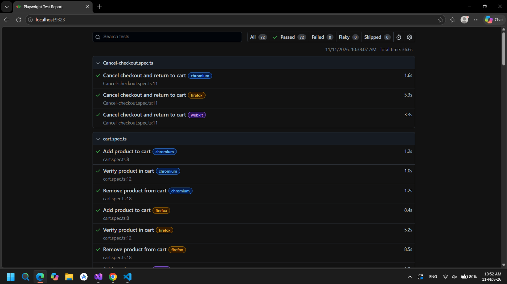

# Playwright UI Automation

Playwright end-to-end tests for the publicly hosted [SauceDemo](https://www.saucedemo.com/) shopping application. The suite uses TypeScript and `@playwright/test`.

## Project structure

```text
tests/
  authentication/  Login and session scenarios
  cart/            Cart contents, navigation, and quantity behavior
  checkout/        Validation, order totals, cancellation, and completion
  inventory/       Product details, inventory content, and sorting
specs/
  test.plan.md     Regression test plan
```

See the [regression test plan](specs/test.plan.md) for scenario steps and expected results. Each test creates its own application state using SauceDemo's public demo accounts.

## Run tests

Install dependencies:

```bash
npm install
```

Run the full suite in all configured browser projects (Chromium, Firefox, and WebKit):

```bash
npx playwright test
```

Run a feature folder in Chromium:

```bash
npx playwright test tests/cart --project=chromium
```

Run a single spec:

```bash
npx playwright test tests/inventory/sorting.spec.ts --project=chromium
```

Open the latest HTML report:

```bash
npx playwright show-report
```

Tests access the live SauceDemo site, so they require network access and may be affected by changes or outages of that external service.

## Test coverage

- **Authentication:** valid login; missing, unknown, and incorrect credentials; locked-out account; logout and browser history.
- **Inventory:** product content and details; exact product order and prices for all four name and price sort options.
- **Cart:** adding/removing products, retained contents, and empty-cart behavior. Cart quantities display as one per item; the application provides no quantity-edit control.
- **Checkout:** required customer fields, totals calculated from item prices and tax, cancellation from both checkout steps, and order completion with cart clearing.


